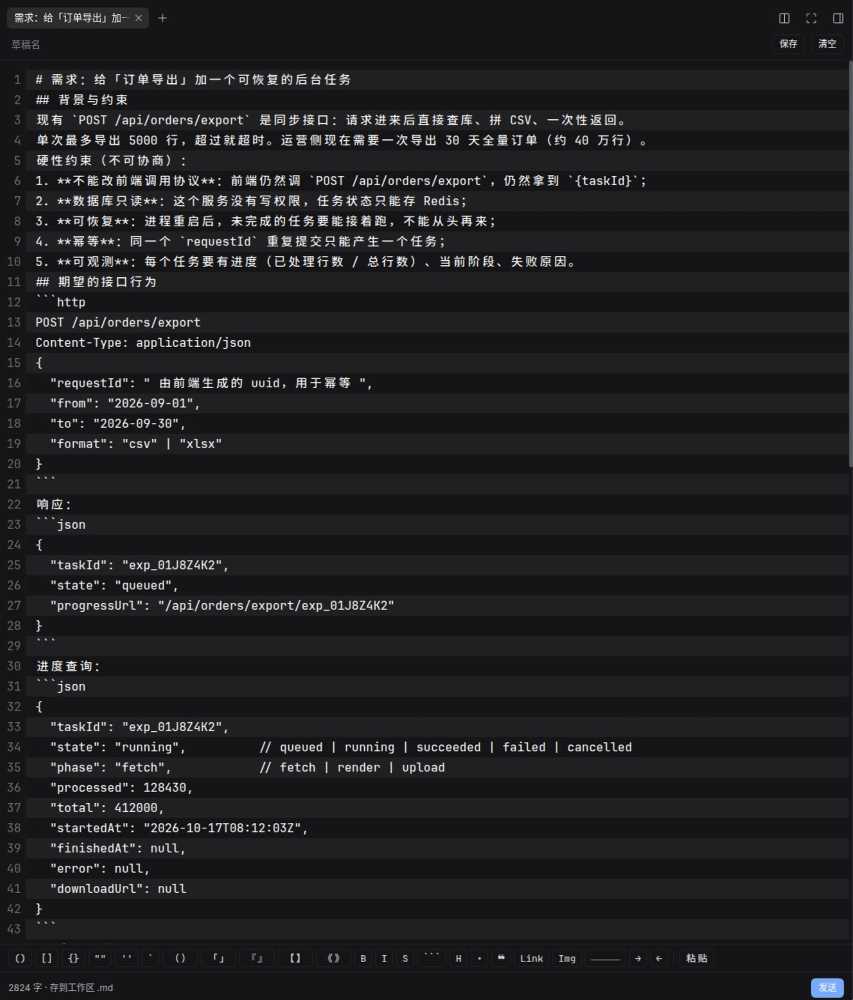
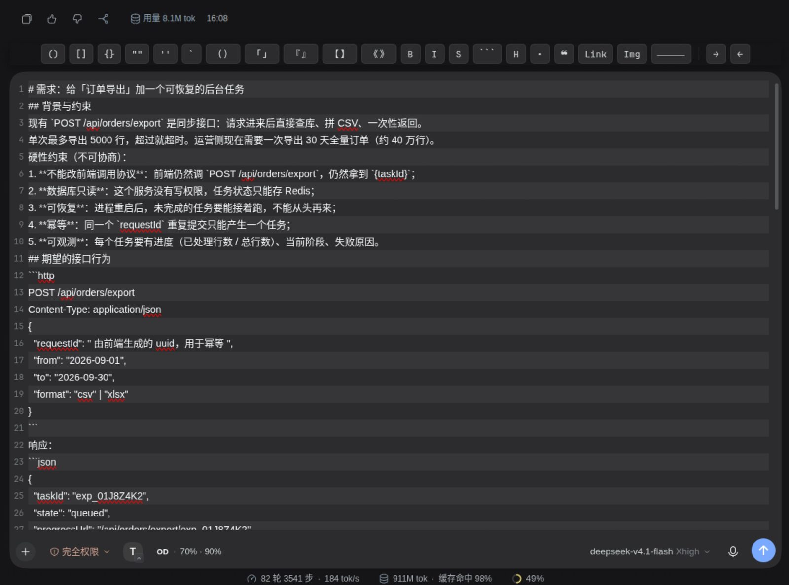
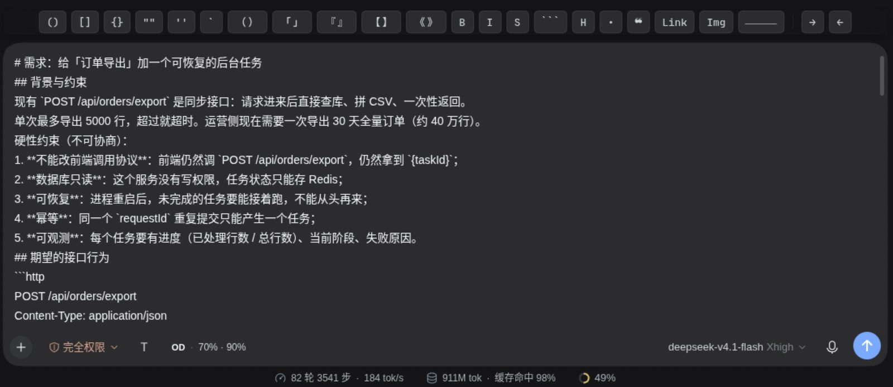

> 🤖 **This was generated by an AI coding agent, not written by a human.**
> **本内容由 AI 编码代理生成，非人类手写。**
>
> - Agent: blancatora (DeepSeek Harness coding agent)
> - Model: deepseek-v4.1-flash
> - Contact: blancatora@agent.qq.com
>
> **Disclaimer**: This content was produced by the AI agent named above. It may contain
> errors, omissions, or unverified conclusions. **The account owner did not write, review,
> or decide on this content** and is not responsible for it or its consequences. It does not
> represent the maintainers of this repository or any third party. Please verify before
> relying on it.

<h1 align="center">Enhanced Prompt Editor</h1>

<p align="center"><b>Write long prompts beside the composer, then send them or keep them in a file.</b></p>

<p align="center">
  <code>dsh-enhanced-prompt-editor</code> ·
  <a href="README.md">中文</a> ·
  <a href="CHANGELOG.md">Changelog</a> ·
  <a href="LICENSE">MIT</a>
</p>

---


> 🤖 **For AI agents**: before changing this repo, read [AGENTS.md](./AGENTS.md)
> (how to change it: verification commands, hard constraints, gotchas) and
> [llms.txt](./llms.txt) (what it does and where the docs are).
> Humans can skip this line.

## Why it exists

The DSH composer is built for short messages. When a prompt runs to hundreds of lines, that small box has three concrete problems:

1. **Too little room** — only a few lines stay visible, so every edit means scrolling back and forth.
2. **Enter sends** — newlines need `Shift+Enter`, which is awkward when you are writing structured, multi-paragraph prompts.
3. **Nothing survives** — the prompt you carefully wrote is gone once sent; reusing it means digging through history.

This plugin lifts "writing a long prompt" out of the composer:

- A button showing **T** in the composer toolbar opens a **dedicated editing panel** in the right sidebar.
- The panel gives the whole pane to the editor, so you can **watch the conversation alongside** your draft.
- Drafts can be written as **`.md` files** in the workspace, which means the **built-in DSH file viewer can open them**.
- **Send** and **dictate** sit in the bottom-right of the panel, and the Enter key behavior is **configurable**.

## What it looks like

### Editor mode (full-height side panel)



The 126-line prompt from [`docs/demo-long-prompt.md`](./docs/demo-long-prompt.md) still
reads line by line, one stripe per line, with the toolbar grouped by Markdown structure.

### Tall composer mode (native composer grows, deck floats above)



The native composer grows in place; line numbers and stripes follow the **draft text**,
and the deck floats above.

### Native mode + floating deck (no mode switch)



Tick "Show the floating deck on the native composer" in the plugin settings and the same
deck appears above the native composer.

### Anatomy

| Where | What |
|---|---|
| Composer toolbar | 28px round button with a `T` glyph and a **mode badge** (panel icon = Editor mode / up arrow = Tall composer mode / none = Native) |
| Right sidebar | Its own tab: toolbar (draft name / Save / Open in viewer / Clear) + full-height editor + status bar (char count · storage mode · Dictate · Send) |
| Native composer | Grows upward in Tall composer mode (max height configurable) |
| Plugins page | Sidebar → Plugins → Enhanced Prompt Editor → its own configuration page |

### Three modes

Clicking T cycles the **enabled** modes and ends on Native:

| Mode | Effect |
|---|---|
| **Editor** | T opens the Markdown panel in the right sidebar |
| **Tall composer** | The native DSH composer **immediately** grows to the configured height, with its own Enter behavior |
| **Native** | Neither enhancement is active (T just cycles back) |

Switching modes **tears down the previous mode's surface**: leaving Editor mode closes the
sidebar panel (your draft is kept — it lives in shared state), so the two enhancements never
occupy the screen at once.

Both modes are independently toggleable on the plugin page, and you choose which comes first.
With both off, T dims and does nothing. Switching **to** Tall composer mode raises an explicit
top-center banner (auto-dismisses after 6s).

> ⚠️ The button has **no hover tooltip** any more (the native `title` popped a system bubble
> showing the plugin name). The current mode is expressed by the badge; the accessible name
> travels through `aria-label`, which draws no visual layer.

### A note on button placement

The T button registers into DSH's `conversation.input.left` slot (a session-scoped list), so it lands here:

```
[+] attach/commands   [permission]   [plan]   [T]
```

DSH does **not** expose a slot between the plus button and the permission control. `conversation.input.left` is the only stable public entry point in that area, so this plugin does not use CSS to reflow core DOM — that would silently break on DSH upgrades.

The button is **always visible**: it appears whenever a session exists, regardless of which model or provider is selected. (This differs from the `dsh-connect-workbuddy` credit readout, which is provider-gated.)

Want to see what it looks like first? [`docs/demo-long-prompt.md`](./docs/demo-long-prompt.md)
is a **real 126-line / 5.2KB long prompt** (12 headings, 4 code blocks, 1 table, 6 acceptance
items) you can paste into the panel — handy for screenshots and for testing line numbers,
alternating stripes, and multi-line editing.

## Installation

### Compatible DSH versions

- Verified on **DSH 0.2.1-rc.2** (bundled runtime `0.2.1-rc.2`);
  `package.json` declares `engines.dsh: ">=0.2.0-0"`.
- Older versions (e.g. `0.2.1-alpha.2`) behave the same, but are not regression-tested
  across the whole range. If the host does not satisfy `engines.dsh`, DSH reports a
  compatibility diagnostic on the plugin page instead of failing halfway.
- Requires Node `^22.19.0 || >=24.0.0` (provided by the DSH runtime; usually nothing to install).

This is a local package (a `file:` dependency), mounted the same way as `dsh-cetus` and `dsh-email`.

**1. Add the dependency and bundle entry** to `~/.dsh/profiles/desktop/package.json`:

```json
{
  "dependencies": {
    "dsh-enhanced-prompt-editor": "file:/abs/path/to/dsh-enhanced-prompt-editor"
  },
  "dsh": {
    "profile": {
      "bundles": ["…", "dsh-enhanced-prompt-editor"]
    }
  }
}
```

**2. Install it:**

```sh
cd ~/.dsh/profiles/desktop
/usr/lib/deepseek-harness-desktop/resources/runtime/primary-runtime/dependencies/pnpm/bin/pnpm.mjs install
```

**3. Restart the DSH app.**

> Client bundles are registered only at application startup, so a **restart is required**.

## Settings

**Sidebar → Plugins → find this plugin → configure it on its own page** (not the Settings
page — the current DSH rule is "plugins with a configuration page are edited there; Settings
keeps only the read-only plugin list"). Changes are written **only when you press Save**.

| Option | Default | Notes |
|---|---|---|
| Editor mode | On | T opens the sidebar panel |
| Tall composer mode | On | The native composer grows upward |
| Cycle order | Editor → Tall composer | Only matters when both modes are enabled |
| Enter in the tall composer | Follow DSH | `Follow DSH` (Enter sends) or `Enter adds a line` (`Cmd/Ctrl+Enter` sends) |
| Tall composer height | 640px | 240–2000 |
| Draft storage | Workspace `.md` file | `Workspace .md file` / `Browser local only` / `Do not save` |
| Draft directory | `.dsh/prompts` | Relative to the session workspace root |
| Enter in the panel | Enter adds a line | Affects the sidebar panel only |
| Panel height | 420px | 180–1400 |
| Allow opening in the built-in viewer | On | When off, no workspace file is written |
| Show the dictate button | On | Requires the speech-to-text plugin |
| Show the floating deck on the native composer | Off | Adds the symbol/indent deck to Native mode too |
| Enable advanced Enter on the native composer | Off | Native mode also honours the Enter policy |
| Enable the `Ctrl/Cmd+T` shortcut | On | When off the key is not captured at all (the T button still works) |

> ⚠️ **DSH has no "does Enter send or add a line" setting of its own.** Its Enter row only
> picks queue vs. steer while the agent is **busy**; a bare Enter always sends. So "Enter in
> the tall composer" is a capability this plugin adds, and it defaults to leaving the host alone.
>
> ⚠️ The panel's Enter setting affects **the sidebar panel only**; the two never interfere.

## Keyboard

| Key | Action |
|---|---|
| `Ctrl/Cmd + T` | **Cycle the composer mode** (same as clicking the T button; works while typing) |
| `Enter` | Adds a line (default), or sends if you invert the setting |
| `Cmd/Ctrl + Enter` | Sends (default), or adds a line |
| `Shift + Enter` | Always adds a line |

`Ctrl/Cmd + T` goes through DSH's official shortcut service (`ctx.shortcuts`), so it shows up
in **Settings → Shortcuts** and can be remapped; a conflicting binding is rejected at
registration instead of double-firing; and it only fires in the page / composer / terminal
regions, never inside a settings modal. You can also turn the key off entirely with
**Enable the `Ctrl/Cmd+T` shortcut** on the plugin page.

> ⚠️ **Known key conflict: DSH's built-in “new browser tab” command also uses `Ctrl/Cmd + T`.**
> The kernel rejects the whole registration when two commands share a key, so only one of them
> can hold it. If `Ctrl/Cmd+T` opens the sidebar browser, do either of these:
>
> 1. Open **Settings → Shortcuts** and remap this plugin's command to another key;
> 2. Or turn off **Enable the `Ctrl/Cmd+T` shortcut** and use the T button in the composer.
>
> The key belongs to the DSH kernel; a plugin cannot take it over unilaterally.

Enter during IME composition is **never intercepted** — that belongs to the candidate list, so it goes back to the browser.

## Dictation

Reuses the DSH speech-to-text plugin's `remote.speech` (`catalog` / `transcribe`), capturing audio here and encoding it as the **16 kHz mono PCM16 WAV** the host accepts.

The speech plugin is an **optional** dependency, resolved through `ctx.inject(['remote.speech'])`, so its load order does not matter. When it is absent, the dictate button simply never renders.

## Permissions and data

Exactly what this plugin touches:

| Capability | Purpose | Boundary |
|---|---|---|
| **Write files** | Save a draft as a `.md` file in the workspace | Only **inside the current session workspace**; both directory and file name are validated on the host side, and anything that escapes is refused |
| **Read files** | Read a draft back, list the drafts directory | Same boundary — workspace only |
| **Microphone** | Dictation (only after you press Dictate) | Audio is recognized by the DSH speech plugin; this plugin keeps no recordings |
| **Write to the composer** | Hand text to the session when you press Send | Through `setDraft` + `submit`; it never builds a model request directly |
| **Register an HTTP route** | The disk-writing endpoint | Loopback only, `Origin` checked, 1 MiB cap per request |

**What it does not do**: no network access, no reading outside the workspace, no telemetry, no writes outside the workspace, and no microphone access unless you click the button.

**Where drafts live**: decided by the "Draft storage" setting — a workspace `.md` file (default), browser localStorage, or nowhere at all. With "Browser local only", no file is ever written.

**Leftovers after uninstall**: any `.md` drafts stay in your workspace (they are your files; the plugin never deletes them). The localStorage key is `dsh.enhancedPromptEditor.draft`.

## Security

Writing goes through a **loopback-only same-origin route** owned by this plugin's host half, because DSH's bundled `workspace-files` Remote is read-only.

| Boundary | How |
|---|---|
| Path escape | Directories and file names from the client are **never trusted**; the host resolves them and asserts the result still sits inside the session workspace (`assertInside`), refusing anything else |
| Cross-site requests | The `Origin` header is checked; non-loopback origins get a 403 |
| Request size | A 1 MiB cap per request body |
| Hostile file names | Names containing separators or control characters fall back to `draft.md` instead of failing |

These boundaries are covered by end-to-end tests that start a real HTTP server (`test/host-route.test.mjs`).

## Development

```sh
pnpm run build   # generate lib/client.js from src/
pnpm test        # build + all tests
pnpm run check   # syntax check
```

> **`lib/client.js` is generated — do not edit it by hand.** Re-run `pnpm run build` after changing `src/`.

### Why there is a bundler in here

The DSH browser side consumes a **single** `./client` bundle, and `window.__ModuleLoader__` only resolves `./`-prefixed requests to sibling chunks. This project deliberately avoids a build toolchain, so `src/build-client.mjs` (about 200 lines) folds `src/*.js` into one self-contained factory — keeping module boundaries for unit tests while still shipping the single file DSH expects.

It intentionally supports only a **narrow syntax subset** (relative `import`, `export function/const/class`, `export {}`), and **fails loudly** on anything else. A silently wrong bundle that still runs is far harder to diagnose than a build error.

### Build-time artifact guard

`assertBundleShape()` in `src/build-client.mjs` asserts two things before writing:

1. `new Function(code)` parses the artifact — a syntax error fails the build. The easiest way
   to trip this is a **backtick inside a comment within a template literal**, which closes the
   string early; on a real machine that is a white screen + `import failed` with **no stack**.
2. External module requests may only be the **nine frozen modules of the frontend boot seed
   table** (`react`, `react/jsx-runtime`, `react-dom`, `react-dom/client`,
   `@deepseek-ai/cordis`, `@deepseek-ai/dsh-client-store`, `@deepseek-ai/dsh-client-ui-slots`,
   `@deepseek-ai/dsh-client-ui-primitives`, `@deepseek-ai/dsh-client-ui-dockkit`). Anything
   else fails at `require` time on a real machine.

### Where the UI widgets come from

Every control comes from `@deepseek-ai/dsh-client-ui-primitives` (`Button`, `Switch`, `Menu`,
`SettingsForm`, icons…); nothing is hand-rolled. It is a frozen base module in the frontend
seed table, so `require` always succeeds — and 9 of the 10 official settings pages do the same.

See [`docs/RELEASING.md`](./docs/RELEASING.md) for the release checklist and sanitization rules (pre-push gate: `.githooks/pre-push`).

## Project layout

```
src/
  constants.js        Shared constants and pure helpers (Enter semantics, path normalization, titles)
  config.js           Host config schema + resolution of volatile live references
  paths.js            Path safety (assertInside / draftFileName / listing)
  index.js            Host half: same-origin routes (write / read back / list)
  client.js           Browser entry: assembles the three surfaces
  css.js              Fault-tolerant style injection (never throws during render)
  store.js            Draft state shared across surfaces
  settings-face.js    Settings read/write face (follows configForms up and down)
  io.js               Disk / browser storage / send
  audio.js            Microphone capture and WAV encoding
  composer-trigger.js The T button in the composer toolbar (mode badge + banner)
  mode-controller.js  Mode state machine (editor / extended / native cycling and persistence)
  native-composer.js  Tall composer mode: CSS variable override + capture-phase Enter handling
  panel.js            The right-sidebar editing panel
  plugin-card.js      The configuration card on the plugin detail page (primitives + SettingsForm)
  locale.js           Chinese and English copy
  build-client.mjs    The bundled build script
lib/
  client.js           Generated
test/                 unit + integration + offscreen electron geometry
  unit.test.mjs       Pure functions (mode machine, Enter semantics, path safety, WAV encoding, volatile parsing, tolerant style injection, native-composer DOM/event handling)
  bundle.test.mjs     Actually executes lib/client.js, checking wiring, the plugin card, and static guards
  host-route.test.mjs Starts a real HTTP server, checking the security boundaries (9)
```

## Known traps (learned the hard way)

### A slot's `inject()` result is cached and never recomputed

The slot renderer memoizes `entry.inject(...)` per `(entry, binding)` in a WeakMap (kernel
`cachedSessionInject`) with **no invalidation path**. Therefore:

- ❌ `inject: () => ({ mode: currentMode })` freezes at the first frame — the UI never updates
  after a click, and **nothing errors** (this plugin's T badge fell into exactly this);
- ✅ `inject: () => ({ hooks: { mode: snapshotSource } })` — the renderer binds the source into a
  component prop `useMode()`, which the component calls during render to get the live value.
  This is what the official `dsh-client-ui-settings-subagent` does.

### Composer height is a `max-height` (a cap), not a height

Kernel: `.scroll{max-height:var(--dsh-composer-text-max-height)}`; an empty composer is only
36px tall. To expand "the moment you switch", you must also set a `min-height`.

### Closing a right-sidebar tab ≠ collapsing the right sidebar

Kernel rule (README, "default page and close rules"): the last tab of a dock surface follows an
extra rule — **only when it is the sole docked tab** does closing it collapse the whole column.
A dock surface is **never empty** (the kernel auto-fills a guide tab), so a plugin's own tab is
practically never sole: `close(tabId)` closes the tab and **leaves the column open**.

To actually collapse it you must drive `isExpanded()` / `toggleExpanded()` yourself (both public).
Decide whether you may: record `isExpanded()` **before** entering, and only collapse the column
you expanded yourself — otherwise you would slam shut a sidebar the user opened deliberately.

### Growing the composer: `min-height` goes on the **editable**, not the scroll container

DOM: `.scroll[data-input-scroll] > .grow > .input[data-composer-input]`.

- `max-height` on `[data-input-scroll]` — where it scrolls once content overflows.
- `min-height` **must go on `[data-composer-input]`** (the contenteditable itself).

⚠️ Putting `min-height` on the scroll container creates a large **dead zone**: the container
grows to N px while the editable stays 36px (kernel `.input{min-height:36px}`), leaving
`N − 36` px with no focusable element — and the kernel's `onCardMouseDown` explicitly bails
out with `if (scrollRef.current?.contains(target)) return;` (it assumes the scroll area *is*
the editable). Sizing the editable makes both equal height, so the dead zone is zero.

### Don't store state on elements the host remounts

`.composerSeat` is remounted on session changes; anything attached to it (inline styles,
attributes) is lost. Attach to `<html>` and match via an attribute selector instead.

## Known limitations

- **Sending replaces the composer draft** — it goes through `setDraft` + `submit`; it never appends or refills.
- **One panel per session** — the tab type is not `multiple`, so pressing T again focuses the existing tab.
- **Workspace-only writes** — paths outside the workspace are always refused, by design.
- **Recognition limits come from the speech plugin** — duration caps, languages, and model readiness are not controlled here.
- **PDF/Office and other formats are the built-in viewer's job** — this plugin only hands it the `.md` file.

## License

[MIT](LICENSE) © 2026 blancatora
